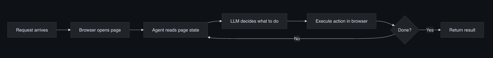
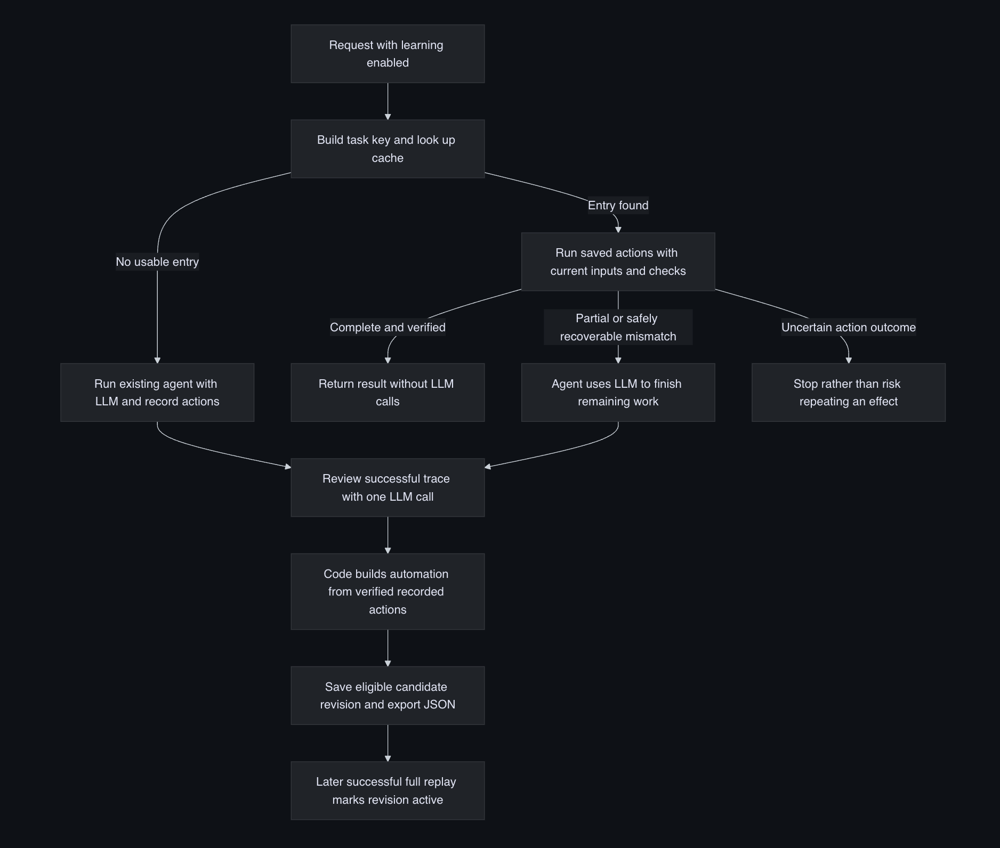

# Action Memory Layer

## The Problem

Every time an Optexity automation runs an agentic task, browser-use reads the page, calls an LLM to decide what to click or type, executes the action, and repeats — even for identical steps it has done before. Filling in a name, address, and city on the same form every day costs the same tokens and takes the same time every single run.

The goal: **learn a workflow once, replay it without the LLM every time after.**

---

## How the Agentic Workflow Changed

### Before — every run is fresh



Every arrow back to C is an LLM call. A 4-field form fill = 3–4 LLM calls, ~20 seconds.

---

### After — learn once, replay fast



**LLM calls added by this system:**

| When | LLM calls |
|------|-----------|
| First run (learning) | Agent calls as usual + **1 review call** at the end |
| Every repeat run | **0** |
| Partial replay mismatch (recovery) | Agent runs for remaining steps only + **1 review call** (rebuilds/extends cache) |

---

## How the Cache Is Built

The cache is built from actual execution, not from the LLM inventing steps.

1. **Agent runs normally** with an attached recorder. Every action the agent takes — click, fill, navigate — is observed.

2. **For each action**, before the page changes, the recorder:
   - Looks up the clicked/typed element in the browser
   - Finds a stable CSS or ARIA selector (e.g. `locator('input[name="04fullname"]')`) that will work on future runs
   - Confirms the action worked — field value matches, URL changed, or download file hash matches (using CDP to observe downloads)

3. **One LLM review call** reads the full verified trace and answers two questions:
   - Which steps were fixed choices (fill this field, click this link) vs. exploration?
   - Does the verified set of steps fully complete the objective?

4. **The cache entry** is built from only the steps that passed all checks: unique stable locator, verified effect, and classified as deterministic by the LLM review. Wait actions are removed if a following verified locator makes them unnecessary. 

> **No LLM is used to write the automation code.** The selectors, URLs, and values come entirely from what actually happened in the browser. The LLM review only filters — it cannot add steps or selectors that weren't in the trace.

---

## How the Final Automation Is Created

After a successful learning run, the system automatically writes `automation_cached.json` — the same format as any Optexity automation:

```json
{
  "nodes": [
    {
      "interaction_action": {
        "deterministic_only": true,
        "replay_guard": {
          "before_url": "https://www.roboform.com/filling-test-all-fields",
          "after_url":  "https://www.roboform.com/filling-test-all-fields",
          "value": "{first_name[0]}"
        },
        "input_text": {
          "command": "locator('input[name=\"04fullname\"]')",
          "input_text": "{first_name[0]}"
        }
      }
    }
  ]
}
```

Note that `{first_name[0]}` stays as a symbol — the actual name is injected at runtime. The same cached automation works for any name, not just the one used when learning.

---

## Files Added or Changed

### `browser-use` fork

| File | What changed |
|------|-------------|
| `browser_use/agent/views.py` | Added `ActionExecutionEvent` — a data class carrying action details, results, and timing |
| `browser_use/agent/service.py` | Added `action_execution_callback` to `Agent` — calls the recorder before and after every browser action |

### `optexity` repo

| File | What changed |
|------|-------------|
| `optexity/inference/core/interaction/action_memory.py` | **New file.** All recording, cache storage, validation, recovery, and replay logic |
| `optexity/schema/actions/interaction_action.py` | Added `learning` config field, `replay_guard` (URL/value checks), `deterministic_only` flag |
| `optexity/inference/core/interaction/handle_agentic_task.py` | Routes learning-enabled tasks through the memory layer |
| `optexity/inference/core/run_interaction.py` | When `deterministic_only=True`, executes via Playwright directly — no LLM fallback |
| `optexity/inference/infra/browser.py` | Enables CDP download events so downloads can be observed and verified before the page closes |
| `optexity/inference/child_process.py` | Reads automation from a local JSON file when `DEPLOYMENT=dev` |

---

## How to Run

### 1. Start the server

```bash
cd optexity
export DEPLOYMENT=dev
export OPTEXITY_LEARNING_CACHE_DIR="$PWD/optexity-parameter-cache"
export OPTEXITY_LOCAL_AUTOMATION_PATH="$PWD/test_automation.json"
optexity inference --port 9000 --child_process_id 0
```

### 2. Trigger a task

```bash
curl -sS -X POST http://localhost:9000/inference \
  -H 'Content-Type: application/json' \
  --data-binary '{
    "endpoint_name": "fill_roboform_test_form-60da7865",
    "input_parameters": {
      "first_name": ["John"], "address_line_1": ["123 Main St"],
      "address_line_2": ["Apt 4B"], "city": ["Anytown"]
    },
    "unique_parameter_names": [], "secure_parameters": {}, "is_dedicated": false
  }'
```

Run it once — it learns. Run it again — it replays.

### 3. Check the output

```bash
find /tmp/optexity/<TASK_ID> -name "metrics.json"    # timing, token counts, cache status
find /tmp/optexity/<TASK_ID> -name "automation_cached.json"  # the generated automation
ls optexity-parameter-cache/                         # persisted cache entries
```

---

## Test Results

### Workflow 1: RoboForm (4-field form fill)

| Run | LLM calls | Tokens used | Time |
|-----|-----------|-------------|------|
| First run (learning) | 4 | ~19,000 input / 2,100 output | 19 s |
| Second run (replay, same values) | **0** | **0** | **0.30 s** |
| Third run (replay, different values) | **0** | **0** | **0.21 s** |

Replay is **~65× faster** and uses **zero tokens**.

### Workflow 2: Multi-step download & Cache Recovery

This tests an initial learning run clicking a download, followed by changing the target file to `1.png` which requires rebuilding the cache from a partial hit.

| Run | Result | Time | LLM calls |
|-----|--------|------|-----------|
| First run (`ab9a9066`) | Learned navigation and download clicks | 63 s | 4 agent + 1 review |
| Replay (`ffef221d`) | Full hit, replayed 2 actions | 1.1 s | **0** |
| Target changed to `1.png` (`7fb1ec7b`) | Partial hit. Reused 1 step, learned new download | 18 s | 3 agent + 1 review |
| Replay new `1.png` task (`3b87b6f2`) | Full hit, replayed 2 actions | 0.8 s | **0** |

Downloads are verified by SHA-256 hash. If an unsupported step happens during learning, or a step fails during replay, the cache naturally extends itself on the next run by seamlessly handing control back to the agent for the remaining steps.

---

## Storage: Local Now, Production Later

### Current (development)

- Cache stored in `optexity-parameter-cache/` inside the repo directory (set via `OPTEXITY_LEARNING_CACHE_DIR`)
- Each entry is a folder named by a SHA-256 key containing `manifest.json` and one JSON file per revision
- Per-run evidence (actions, metrics, exported automation) written to `/tmp/optexity/<task-id>/`

### For production

Three changes would be needed:

1. **Shared storage** — Move the cache from local disk to a shared location (S3, a database, or a shared network volume) so all workers see the same cache. `read_entry` and `publish_entry` would need conditional updates to prevent race conditions.
2. **Dashboard Integration** — Remove the local JSON overrides. The deployed API would need to support the `learning` configuration block and the new deterministic replay fields.
3. **Data Protection & Cleanup** — Cache keys separate lookups (they include user/workspace) but don't replace real access control. Old trace files and unneeded revisions in the cache would need automatic cleanup rules.

---

## Limitations

- **Page must stay the same.** If a website redesigns its form fields or renames a download file, the cached locators break. (Though the system handles this safely by falling back to the agent).
- **No looping or branching.** If a task needs to repeat steps for multiple items (e.g. fill 10 rows), that pattern is not learned — it stays agentic.
- **Single-tab only.** Tasks that open new tabs mid-workflow are not supported in this version.
- **Downloads are matched by filename and hash.** If the same filename appears with different content, the replay will detect the hash mismatch and fail safely.
- **Recovery is capped.** If part of the cache replays but then fails, the agent gets at most 5 steps to finish the remaining work. If that's not enough, the run fails.

## Future Improvements

- **Iterative refinement** — Run → cache → replay → if replay fails, re-learn with failure context → repeat. Each cycle makes the automation more stable without human intervention.
- **Shared cache across workers** — Single source of truth in a database rather than per-worker disk.
- **Automatic dashboard sync** — Promote compiled nodes back to the dashboard so the agentic node is replaced entirely after a successful learning run.
- **Smarter redundancy removal** — Currently conservative: if a step is uncertain, everything after it stays agentic. A future version could handle independent branches.
- **Support for loops** — Learn a pattern for processing multiple items rather than just a fixed linear sequence.
